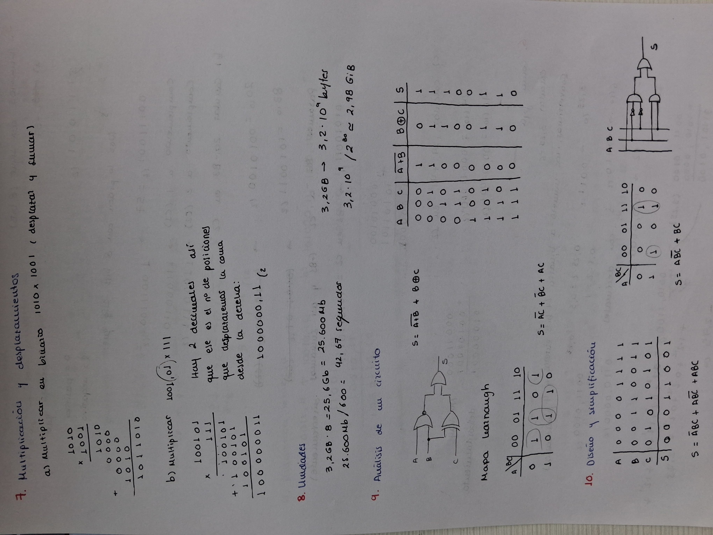
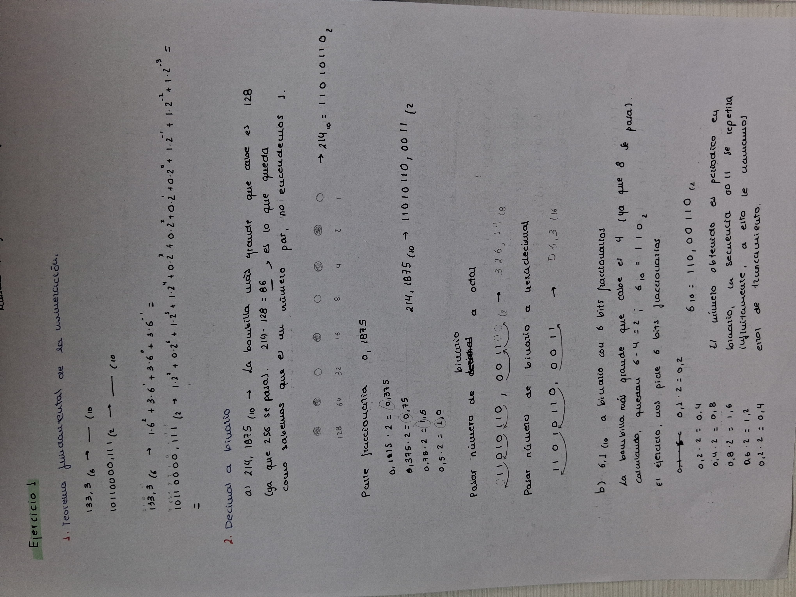
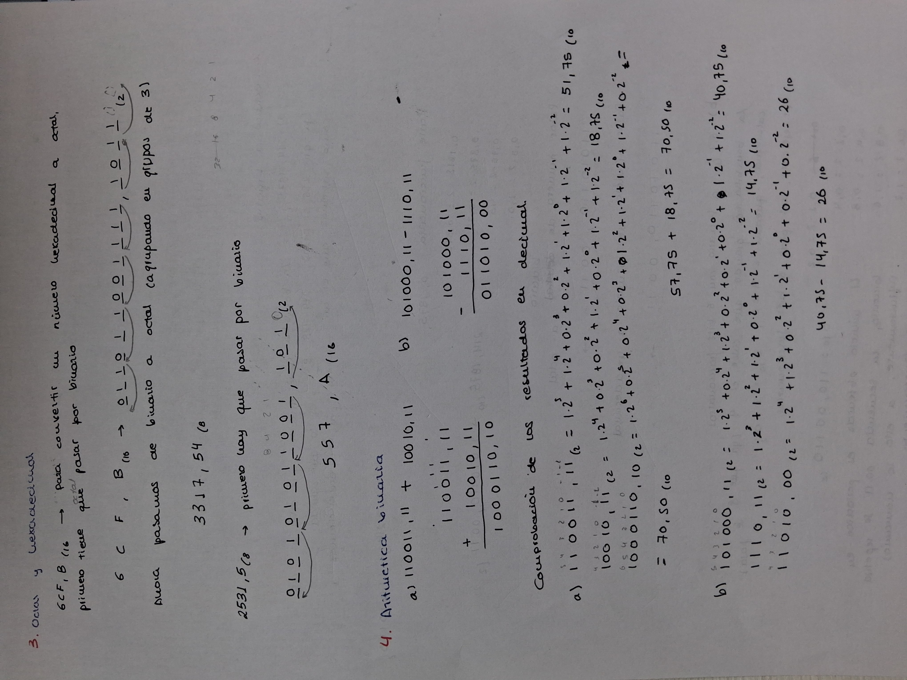
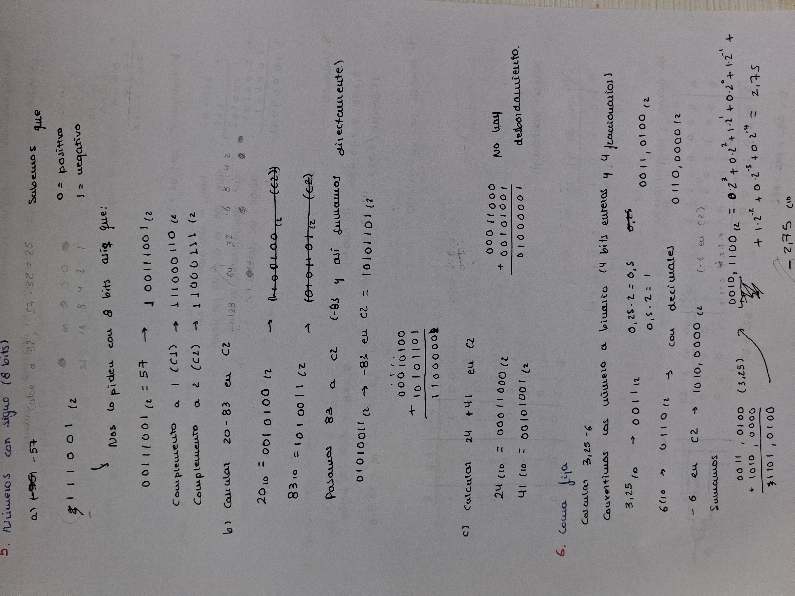
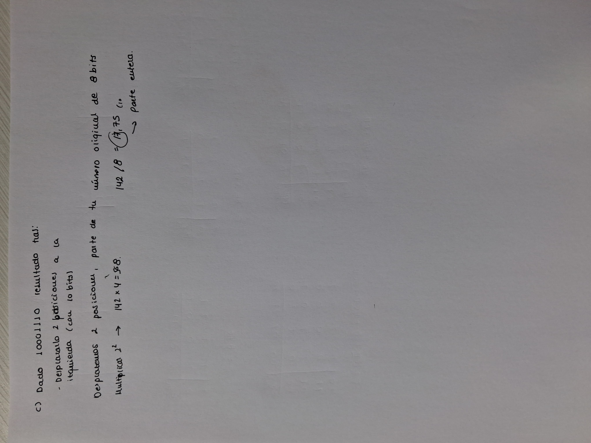

#Relación de Ejercicios de Binario y Puertas Lógicas

> @autor: Maisara

## Relación XX-

### Ejercicio 1
- Apartado a solución = 
- Apartado b solución = 

### Ejercicio 2
- Apartado a solución = 11010110,0011(2		326,14(8	 D6,3(16
- Apartado b solución = 110,00110(2 
	El número obtenido es periódico en binario, la secuencia 0011 se repetirá infinitamente, a esto le llamamos error de tratamiento.
### Ejercicio 3
- Apartado a solución = 
	1. Pasamos a binario antes de pasar a octal
	011011001111,101100(2	--->	3317,54(8
- Apartado b solución =
	1. Pasamos a binario antes de pasar a hexadecimal
	010101011001,1010(2	--->	557,A(16
### Ejercicio 4
- Apartado a solución = 1000110,10(2
- Apartado b solución = 011010,00(2
### Ejercicio 5
- Apartado a solución 
	1. C1 : 111000110(2
	2. C2 : 11000111(2
- Apartado b solución = 11000001(2
- Apartado c solución = 01000001(2	No hay desbordamiento
### Ejercicio 6
- Solución: -2,75(10
### Ejercicio 7
- Apartado a solución = 1011010(2
- Apartado b solución = 1000000,11(2
- Apartado c solución
### Ejercicio 8
- 42,67 segundos
- 2,98 GiB
### Ejercicio 9

|A B C|S|
|-------|
|0 0 0|1|
|0 0 1|1|
|0 1 0|1|
|0 1 1|0|
|1 0 0|0|
|1 0 1|1|
|1 1 0|1|
|1 1 1|0|

(Solución completa en la imagen)

### Ejercicio 10
(Solución completa en la imagen)

## PROCEDIMIENTOS

### Fecha: 05-October-2026
